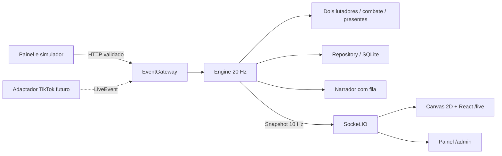

# Arquitetura e adaptadores futuros

## Fluxo de dados



O servidor mantém exatamente dois lutadores definidos pelo operador. O público nunca vira personagem. Comentários alimentam a narração; curtidas fortalecem ambos; novos seguidores soltam armas que os dois podem recolher. Presentes são associados aos IDs dos lutadores na configuração e seus efeitos, remetente, quantidade e alvo aparecem na narração e no placar.

O servidor é a fonte única do estado. A tela vertical desenha a arena 2D em Canvas, interpolando a apresentação sem executar dano ou pontuação. O relógio roda no servidor. Ao terminar o tempo, vence quem somou mais pontos por golpes; há uma tela de resultado e uma nova luta começa após oito segundos, a menos que o operador pause.

`Engine` aceita uma fonte de aleatoriedade injetável e callbacks de persistência, permitindo testes determinísticos. A persistência usa incrementos por usuário/sessão/dia em transações serializadas. A integração TikTok real ainda não está implementada; o painel usa o simulador local.

## Contrato de evento

```ts
interface LiveEvent {
  id: string; // ID estável do provedor, não um UUID novo em cada retry
  type: 'join' | 'comment' | 'like' | 'follow' | 'share' | 'gift';
  username: string;
  text?: string;
  giftId?: string;
  targetId?: string; // usado pelo simulador; conexão real segue o mapeamento administrativo
  count?: number;
}
```

Exemplo para testar sem TikTok:

```json
{
  "id": "simulacao-rosa-001",
  "type": "gift",
  "username": "Carlos",
  "giftId": "rose",
  "count": 10
}
```

POST `/api/admin/simulate`. Use `Authorization: Bearer <ADMIN_TOKEN>` quando configurado. O adaptador de servidor chama diretamente o gateway após normalização, sem expor credenciais ao navegador.

## Checklist de integração real

1. Selecionar provedor e verificar autenticação, limites e acesso com a conta do operador.
2. Implementar `LiveAdapter`, reconexão com backoff e desligamento limpo.
3. Mapear IDs reais dos presentes para IDs configurados. Presentes desconhecidos não concedem poderes.
4. Combos cumulativos exigem buffer e emissão única ao terminar, com ID estável.
5. Persistir IDs processados se o provedor puder reenviar eventos após reinício.
6. Incluir status real de conexão no snapshot apenas após conexão confirmada.
7. Testar desconexão, reconexão, presentes repetidos e mudanças de nome; preferir ID imutável da plataforma.

## API local

| Método / caminho | Função |
|---|---|
| GET `/api/health` | Saúde e estado de persistência |
| GET `/api/state` | Snapshot atual |
| GET `/api/ranking?period=session\|day\|week\|all` | Ranking histórico |
| GET/PUT `/api/admin/config` | Ler/salvar configuração validada |
| POST `/api/admin/simulate` | Simular evento normalizado |
| POST `/api/admin/action` | Iniciar, pausar, resetar ou administrar lutadores/eventos |
| Socket.IO `state` | Snapshot público somente leitura |

O limite HTTP local é 50 requisições por segundo por IP; corpos e dados são validados. Operações administrativas não apagam o ranking histórico.
